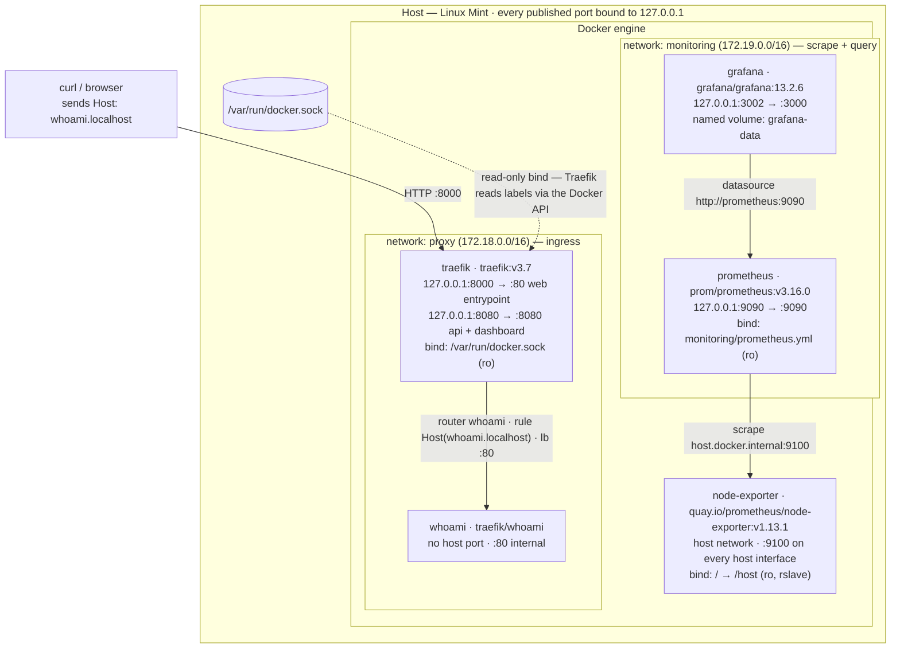
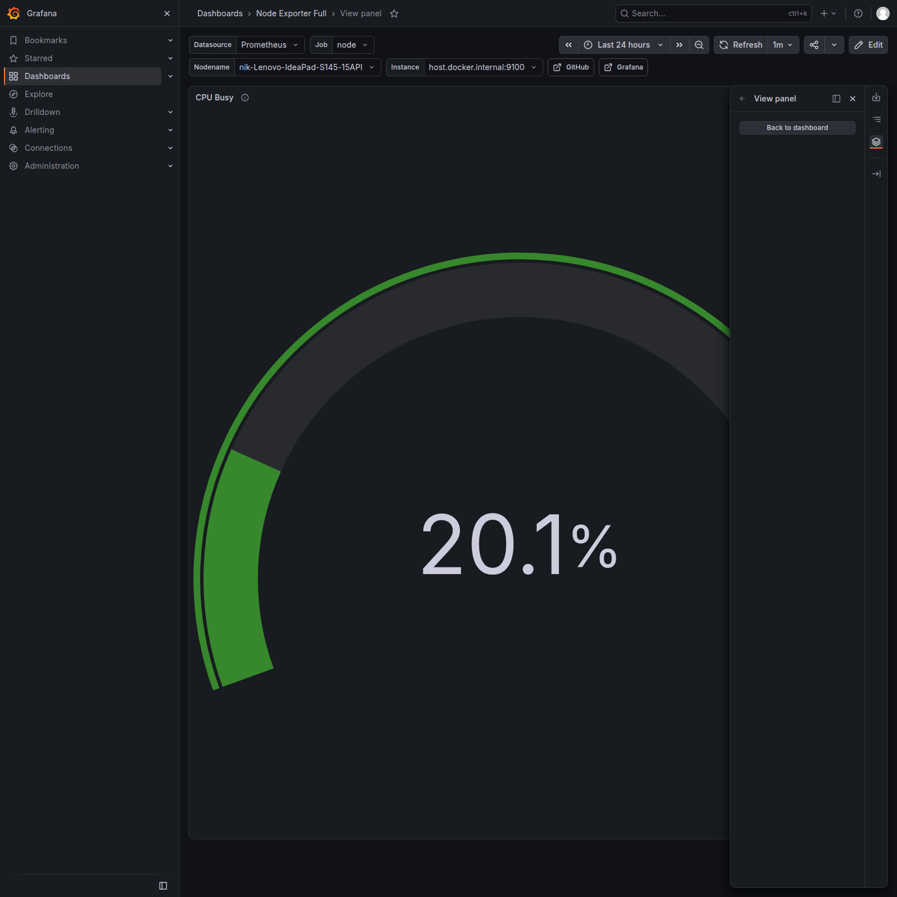
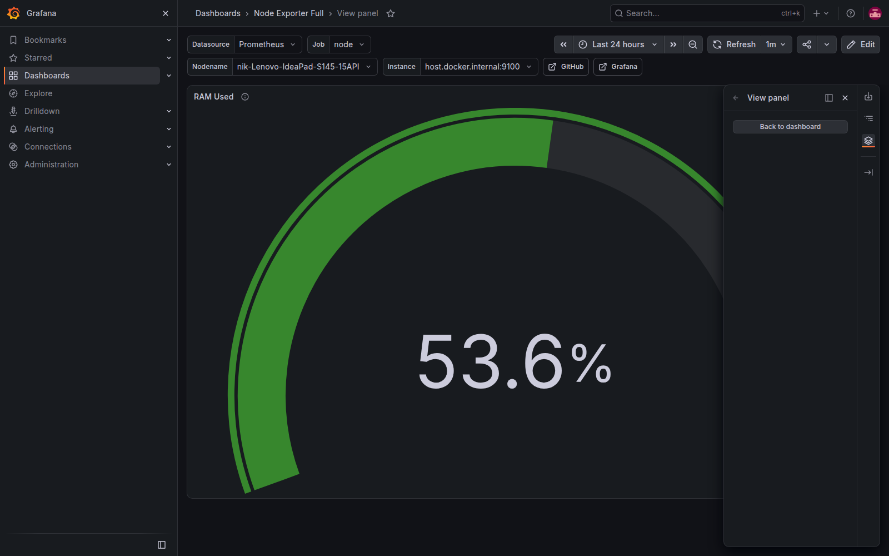
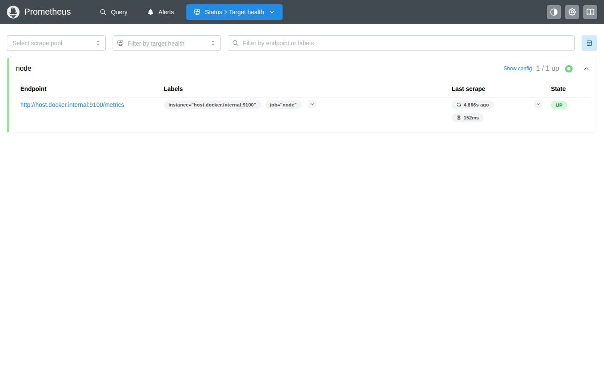
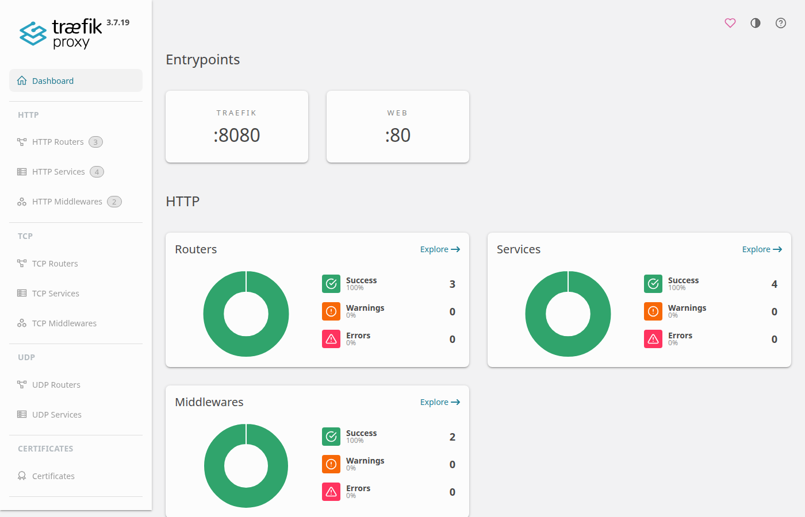

# Homelab — W1

A single-host Docker lab built one `docker run` at a time (no compose files): a Traefik reverse proxy routing to a labelled service, and a Prometheus/Grafana metrics stack scraping the host. Every published port is bound to `127.0.0.1`, so nothing is exposed to the LAN.

Provenance: the W1 commands were executed by an AI agent under my direction and I verified each gate on this machine. The failures below are taken from the session log; where a trap was closed before it fired, the entry says so.

## Stack

| Service | Container | Image | Host port | Volume |
|---|---|---|---|---|
| Reverse proxy | `traefik` | `traefik:v3.7` | `127.0.0.1:8000→80`, `127.0.0.1:8080→8080` | bind `/var/run/docker.sock` (ro) |
| Routed app | `whoami` | `traefik/whoami` (untagged) | none (internal `:80`) | none |
| Host metrics | `node-exporter` | `quay.io/prometheus/node-exporter:v1.13.1` | none — host net, `:9100` on all interfaces | bind `/ → /host` (ro, rslave) |
| TSDB + scraper | `prometheus` | `prom/prometheus:v3.16.0` | `127.0.0.1:9090→9090` | bind `monitoring/prometheus.yml` (ro); no TSDB volume |
| Dashboards | `grafana` | `grafana/grafana:13.2.6` | `127.0.0.1:3002→3000` | named volume `grafana-data` |

All containers run with `--restart unless-stopped`. Port 3002 is used because 3000 is occupied by another local service. Every image is pinned to a tag except `traefik/whoami`, which was run untagged — the one place this build is not reproducible byte-for-byte.

## Build

```bash
docker network create proxy
docker network create monitoring
```

### 1. Traefik + whoami

```bash
docker run -d --name traefik \
  --network proxy \
  -p 127.0.0.1:8080:8080 \
  -p 127.0.0.1:8000:80 \
  -v /var/run/docker.sock:/var/run/docker.sock:ro \
  --restart unless-stopped \
  traefik:v3.7 \
  --api.insecure=true \
  --providers.docker=true \
  --providers.docker.exposedbydefault=false \
  --entrypoints.web.address=:80

docker run -d --name whoami \
  --network proxy \
  --label traefik.enable=true \
  --label 'traefik.http.routers.whoami.rule=Host(`whoami.localhost`)' \
  --label traefik.http.services.whoami.loadbalancer.server.port=80 \
  traefik/whoami

docker update --restart unless-stopped whoami
```

Both containers must sit on `proxy`: Traefik discovers whoami's address over that network, so a container left on the default bridge still gets a router but no reachable backend.

### 2. Node exporter

```bash
docker run -d --name node-exporter \
  --net=host --pid=host \
  -v "/:/host:ro,rslave" \
  --restart unless-stopped \
  quay.io/prometheus/node-exporter:v1.13.1 \
  --path.rootfs=/host
```

`--path.rootfs=/host` is load-bearing: without it the exporter still returns 200 and plausible numbers, but from the container's own filesystem rather than the host's.

### 3. Prometheus

Write the config **before** the run, then validate it:

```bash
mkdir -p ~/homelab/monitoring
cat > ~/homelab/monitoring/prometheus.yml <<'YAML'
global:
  scrape_interval: 15s
scrape_configs:
  - job_name: node
    static_configs:
      - targets: ['host.docker.internal:9100']
YAML

docker run --rm -i --entrypoint /bin/promtool prom/prometheus:v3.16.0 \
  check config /dev/stdin < ~/homelab/monitoring/prometheus.yml

docker run -d --name prometheus \
  --network monitoring \
  --add-host=host.docker.internal:host-gateway \
  -p 127.0.0.1:9090:9090 \
  -v ~/homelab/monitoring/prometheus.yml:/etc/prometheus/prometheus.yml:ro \
  --restart unless-stopped \
  prom/prometheus:v3.16.0
```

There is deliberately no `--memory` cap: a low cap OOM-kills Prometheus mid-scrape. Measured idle use was 29–99 MiB.

### 4. Grafana

```bash
docker run -d --name grafana \
  --network monitoring \
  -p 127.0.0.1:3002:3000 \
  -v grafana-data:/var/lib/grafana \
  --restart unless-stopped \
  grafana/grafana:13.2.6
```

Add a Prometheus datasource at `http://prometheus:9090` (both containers share `monitoring`, so the name resolves), then import dashboard **1860**. The admin password is set at first login and is not stored in this repository.

A named volume is used rather than a host bind mount: the image runs as UID 472 and a fresh host directory is root-owned.

## What broke, and how it was fixed

- **A missing bind-mount path becomes a directory** *(trap closed before it fired)*. Docker creates the host side of a bind mount when it is absent — as a directory. Running Prometheus before `prometheus.yml` exists therefore leaves a directory where the file should be, and the container exits with `read /etc/prometheus/prometheus.yml: is a directory`. Fix: write the config first and validate it with `promtool check config` against the same image.
- **A loopback-published port is unreachable from a container.** Measured from inside a container: `172.17.0.1:7352` (listener on `0.0.0.0`) connects, `172.17.0.1:8000` (published to `127.0.0.1` only) is refused. Fix: the `monitoring` network plus `--add-host=host.docker.internal:host-gateway`, with Grafana using the container name rather than a host IP.
- **The Traefik dashboard returns 200 with zero routers.** It is a single-page-app shell, so a green page proves nothing. Fix: check `curl -s 127.0.0.1:8080/api/http/routers` for `whoami@docker enabled` instead.

A fourth trap worth recording: Prometheus reports `"health":"unknown"` until its first scrape (observed for 17 s). A one-shot `curl` gives a false failure; the gate is a 30-second poll of `/api/v1/targets`.

## Architecture

Full diagram and inventory: [docs/architecture.md](docs/architecture.md).



## Verify

Each line prints the value shown in the comment:

```bash
docker ps --format '{{.Names}}' | sort                                     # grafana, node-exporter, prometheus, traefik, whoami
curl -s 127.0.0.1:8080/api/http/routers | grep -o 'whoami@docker'          # whoami@docker
curl -si -H 'Host: whoami.localhost' http://127.0.0.1:8000/ | head -1      # HTTP/1.1 200 OK
curl -s localhost:9100/metrics | grep -c '^node_'                          # 800+ matching lines (varies with host state; measured 810-883)
curl -s http://127.0.0.1:9090/api/v1/targets | grep -o '"health":"up"'     # "health":"up"
curl -s -o /dev/null -w '%{http_code}\n' http://127.0.0.1:3002/            # 302 (redirect to /login)
```

## Evidence

| | |
|---|---|
|  |  |
| Grafana — CPU Busy, 20.1 %, instance `host.docker.internal:9100` | Grafana — RAM Used |
|  |  |
| Prometheus — 1/1 targets up | Traefik — 3 routers, 0 errors |

The Grafana screenshots were captured with headless Chromium through a temporary local auth proxy: the image ships no `grafana-image-renderer` plugin, so the `/render/` endpoint returns 500.
