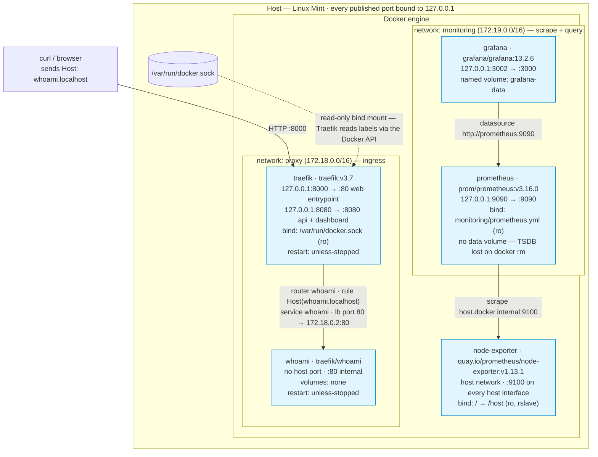

# Homelab Architecture

All five services are running as of 24 Nov 2026 (Day 3 was run a day early). Each node records its container, host port and volume type.

## Service inventory

| Service | Container | Host bind | Volume type |
|---|---|---|---|
| Traefik | `traefik` | `127.0.0.1:8080→8080`, `127.0.0.1:8000→80` | bind `/var/run/docker.sock` (ro) — no data volume |
| whoami | `whoami` | none (internal `:80`) | none |
| node-exporter | `node-exporter` | none published — host net, `:9100` on every host interface | bind `/ → /host` (ro, rslave) |
| Prometheus | `prometheus` | `127.0.0.1:9090→9090` | bind `prometheus.yml` (ro); **no data volume — TSDB lost on `docker rm`** |
| Grafana | `grafana` | `127.0.0.1:3002→3000` | named volume `grafana-data` |

## The two edges that matter

- **Traefik → whoami** — the route is created by container labels, not by config: Traefik reads `traefik.enable=true`, the router rule `Host(whoami.localhost)` and the service port off the Docker API, so both containers must share the `proxy` network or the dial has nowhere to go (504).
- **Prometheus → node-exporter** — node-exporter runs on the host network, so it listens on `:9100` on every host interface; Prometheus reaches it at `host.docker.internal:9100`. A port published to `127.0.0.1` is *not* reachable this way — measured from inside a container, `172.17.0.1:7352` (listener on `0.0.0.0`) connects while `172.17.0.1:8000` (published to loopback only) is connection refused.
